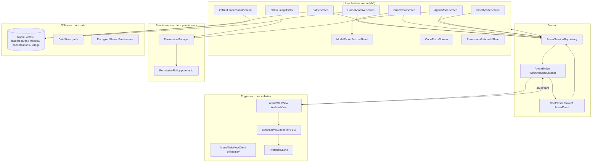
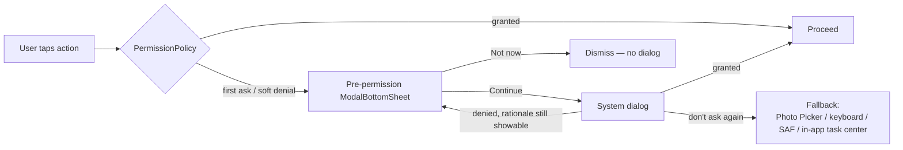

# Arena for Android (ArenaMobile)

A production-grade **Kotlin + Jetpack Compose** client that mirrors
[arena.ai](https://arena.ai) (LMArena): Battle, Direct, Side-by-Side, and Agent
modes, native surfaces where they add value, and a hardened WebView engine
where the Next.js SPA is the source of truth.

> Design rule: **not a WebView wrapper**. Native Compose owns chrome, model
> selection, permissions, offline data, and streaming cards; AndroidX WebKit
> owns the authenticated arena.ai document; a typed JS bridge connects them.

---

## Architecture



### Modules

| Module | Responsibility |
|---|---|
| `:app` | MainActivity, edge-to-edge theme, navigation graph, DI, manifest (permissions declared here) |
| `:feature:arena` | All Compose screens + MVI view models, JS-bridge session, voice dictation, image/code editors |
| `:core:webview` | `ArenaWebView`, `ArenaWebViewClient`, `ArenaBridge`, `SpeculativeLoader` + `PrefetchCache`, offline fallback |
| `:core:sse` | Non-blocking SSE parser decoding `a0:/a1:/a2:/ag:/ad:/a3:` into `Flow<ArenaEvent>` |
| `:core:permissions` | Pure `PermissionPolicy` + `PermissionManager` (contextual, never at launch) |
| `:core:data` | Room offline cache, DataStore prefs, Keystore-backed session store, model catalog, local recommender |
| `:benchmark` | Macrobenchmarks: cold start, WebView FCP, prefetch hit rate, memory overhead |
| `contracts/` | TypeScript mirror of the bridge contract |

---

## Setup

Requirements: **JDK 17**, Android SDK **35**, Android Studio Ladybug+.

```bash
git clone <repo> && cd AAV1
# Android Studio: File ▸ Open ▸ this directory (it bootstraps Gradle)
# CLI (once a Gradle distribution is available):
gradle wrapper --gradle-version 8.9   # generates gradlew + wrapper jar
./gradlew :app:assembleDebug
```

> The Gradle wrapper *jar* is intentionally not committed; Android Studio and
> `gradle wrapper` both generate it.

Run tests:

```bash
./gradlew :core:sse:testDebugUnitTest \
          :core:permissions:testDebugUnitTest \
          :core:data:testDebugUnitTest \
          :core:webview:testDebugUnitTest \
          :feature:arena:testDebugUnitTest
./gradlew :feature:arena:connectedDebugAndroidTest   # Compose UI tests
```

Benchmarks (device/emulator required):

```bash
./gradlew :benchmark:connectedBenchmarkAndroidTest
```

---

## WebView performance — three-tier speculative loading

| Tier | Trigger | Mechanism |
|---|---|---|
| 1 · Preconnect | Cold start, before first frame | `StartupWarmup` + `SpeculativeLoader.preconnect()` — DNS/TCP/TLS warm-up with OkHttp `addQuicHints()` (QUIC where offered) |
| 2 · Prefetch | Auth success / navigation predicted | `SpeculativeLoader.prefetch()` pulls `/chat` + `/arena` shells into `PrefetchCache` (`setMaxPrefetches(2)`, `setPrefetchTtlSeconds(900)`) |
| 3 · Prerender | **Only** after explicit "New Chat" tap | Hidden preloaded `WebView`, hard 30 s TTL, released on real navigation — *never at launch* |

Also applied: back-forward cache (`WebSettingsCompat.setBackForwardCacheEnabled`),
`rememberSaveable` session state (no rotation reload loops), HTTP cache left at
`LOAD_DEFAULT` so SSE/auth are untouched, main-frame `onReceivedError` → native
offline fallback with cached model list + last conversation, renderer-crash
recovery, TLS errors never bypassed.

### Session host

The authenticated arena.ai document lives in one **hidden 1×1 dp WebView**
(`SessionWebViewHost`) that is composed only while a mode screen is on top —
never on Home, never at idle. Native screens drive it through the typed
bridge (`ArenaSessionRepository` queues commands until the page reports
`ready`, then flushes). This keeps a single official session (auth,
reCAPTCHA, token pools stay inside the WebView) without paying renderer
memory when the user is just browsing the leaderboard.

### Benchmarks

- `StartupBenchmark` — cold start, with and without baseline profiles.
- `WebViewFcpBenchmark` — frame timing while the arena.ai document loads.
- `SpeculativeLoadingBenchmark` — prefetch hit rate (cold vs warm pass) and
  PSS memory overhead of the speculative cache.

### Live Preview tab

A fifth Home mode (`preview` route, `HomeMode.PREVIEW`) renders the arena.ai
website itself full-screen, driven by `LivePreviewController` +
`PreviewPerformanceAddon` for "super fast responding":

- **Rendered-frame reuse** — one pooled WebView (application context) is
  re-attached on every tab re-entry: no reload, no SPA re-bootstrap, scroll
  position intact.
- **Connection prewarm** — a rate-limited (60 s) HEAD warm-up opens
  DNS + TCP + TLS right before the tab is shown, even long after cold start.
- **Instant shell serving** — main-frame navigations matching the tier-2
  `PrefetchCache` are answered from disk (`text/html` stream) while the SPA
  revalidates its data over the network; the prewarm refreshes the root shell.
- **Instant Back** — predictive back pops in-page history first (bfcache
  frame restore), then the tab; renderer death bumps a generation counter so
  only a dead frame is ever recreated.
- Offline: native fallback surface over the last frame; refresh retries.

Covered by `LivePreviewStateTest` (pure reducer transitions).

---

## Feature parity map

| Spec item | Where |
|---|---|
| Battle Mode (anonymous A/B, vote, post-vote reveal, cached votes) | `battle/BattleScreen.kt`, `VoteRepository` |
| Vote from notification (heads-up, Model A/B actions) | `battle/BattleVoteNotifications.kt` + `BattleVoteReceiver` |
| Direct Mode (300+ searchable models, provider/rank/modality metadata) | `direct/DirectChatScreen.kt`, `modelpicker/ModelPickerBottomSheet.kt`, `ModelRepository.refresh()` |
| Side-by-Side (synchronized prompt, diff toggle) | `sidebyside/*`, `components/TextDiff.kt` (LCS word diff) |
| Agent Mode (web/files/image tools, timeline stepper, monospace Bash) | `agent/*` + `AgentTaskService` (`dataSync` FGS) |
| Image editor (crop/rotate/filter/send, Photo Picker) | `imageeditor/NativeImageEditorScreen.kt` (Bitmap + ColorMatrix pipeline) |
| Code editor (line numbers, highlighting, sync to coding arena) | `code/CodeEditorScreen.kt` |
| Model switcher grouped by modality + rank badges + Recommended row | `ModelPickerBottomSheet`, `ModelRecommender` (≥5 local interactions) |
| Adaptive home by usage frequency | `home/HomeViewModel.kt` + `ModelRecommender.adaptiveOrder` |
| Offline leaderboard (text/code/image) | `leaderboard/OfflineLeaderboardScreen.kt` |
| Voice-first dictation + waveform | `direct/VoiceDictator.kt` + hold-to-talk mic |
| Clipboard-to-prompt chip | `home/HomeAdaptiveScreen.kt` + `HomePromptBus` |
| Contextual permissions + rationale sheet | `:core:permissions` + `permission/PermissionRationaleSheet.kt` |

---

## Permission flows

Permissions are **declared** in `app/src/main/AndroidManifest.xml` and
**requested only at the moment of first use** — never at launch.



| Use case | Trigger | Fallback on denial |
|---|---|---|
| `CAMERA` | "Take photo" in image editor / agent | Android Photo Picker (no permission) |
| `RECORD_AUDIO` | Hold the mic / voice note | Keyboard entry |
| `READ_MEDIA_*` | "Browse full library" only | Storage Access Framework / Photo Picker |
| `POST_NOTIFICATIONS` | User enables agent/battle notifications | In-app task center |

Single-image selection always uses **`PickVisualMedia` (Photo Picker)** — no
permission at all. `READ_EXTERNAL_STORAGE` is capped at API 32;
`MANAGE_EXTERNAL_STORAGE` is never requested. Denial rates are tracked locally
in `DenialStats` to refine the flow.

> **Screenshots:** capture the rationale sheet + system dialog per use case on
> an API 34 emulator and drop them in `docs/screenshots/`
> (`camera-rationale.png`, `mic-rationale.png`, `notifications-rationale.png`,
> `battle-vote-notification.png`). The flows above are the source of truth
> until then.

---

## JS ↔ Kotlin bridge contract

Kotlin: `core/webview/.../BridgeContract.kt` (`BridgeMessage`, `BridgeCodec`,
`isAllowedArenaOrigin`). TypeScript mirror: [`contracts/arena-bridge.ts`](contracts/arena-bridge.ts).
**Update both together.**

| Type | Direction | Purpose |
|---|---|---|
| `sendPrompt` | Kotlin → JS | Native voice/clipboard/notification prompt injection |
| `vote` | Kotlin → JS | Native/notification Battle votes |
| `switchModel` | Kotlin → JS | Native ModelPickerBottomSheet selection |
| `attachFile` | Kotlin → JS | Native photo/file hand-off for upload |
| `ready` | JS → Kotlin | Page bootstrap complete (flushes queued commands) |
| `stream` | JS → Kotlin | Raw SSE payloads → `SseParser` → `Flow<ArenaEvent>` |
| `agentTaskUpdate` | JS → Kotlin | Agent timeline stepper |
| `ack` | JS → Kotlin | Command correlation |

Transport is `WebViewCompat.addWebMessageListener` with origin rules
`https://arena.ai`, `https://*.arena.ai` — **never** `addJavascriptInterface`.
Every inbound message is re-verified in Kotlin (`isAllowedArenaOrigin`);
payloads are never logged.

## SSE prefixes (`:core:sse`)

| Prefix | Event |
|---|---|
| `a0:` | `TextDelta` slot 0 (primary) |
| `a1:` | `ReasoningDelta` slot 0 |
| `a2:` | `TextDelta` slot 1 (battle B / right pane) |
| `ag:` | `ModelAnnounce` (post-vote reveal; JSON or `id\|Name`) |
| `ad:` | `Done` (+ optional usage JSON) |
| `a3:` | Structured JSON: `agent`, `bash`, `usage`, `reasoning`, `error` |

Parser guarantees: WHATWG SSE state machine (comments, multi-line `data:`,
CRLF), never throws on drift (emits `ProtocolWarning`), never blocks the main
thread, never logs payloads.

---

## Security & compliance

- **No plaintext auth material** — cookies/session strings live in
  `EncryptedSharedPreferences` (AES-256-GCM, Keystore master key); cloud
  backup & device-transfer of all app data are disabled.
- **Origin-locked bridge** — allow-list `https://arena.ai` + subdomains;
  lookalikes (`arena.ai.evil.example`) rejected; main-frame-only handling.
- **reCAPTCHA / token pools** — never automated; the official WebView session
  owns them, the bridge only carries typed messages.
- **Scoped storage only** — Photo Picker, SAF (`OpenDocument`), FileProvider
  for camera captures; `MANAGE_EXTERNAL_STORAGE` never requested.
- **No sensitive logging** — OkHttp BASIC-level logs with redacted
  `Cookie`/`Authorization`; prompts/responses/tokens are never written to
  logcat or analytics.
- **TLS only** — cleartext disabled app-wide via network security config;
  SSL errors cancel and surface natively.

---

## Quality bar / CI suggestions

- JVM unit tests: SSE parser (wire-format contract), permission decision
  matrix, recommender/adaptive order, bridge codec + origin allow-list,
  text diff.
- Compose UI tests: model picker grouping/search/selection, rationale sheet
  Continue/Not-now behaviour.
- Macrobenchmarks: cold start, WebView FCP, prefetch hit rate, memory.
- Add a `ci.yml` running the unit suites on every PR and the macrobenchmarks
  nightly on a managed device pool.
